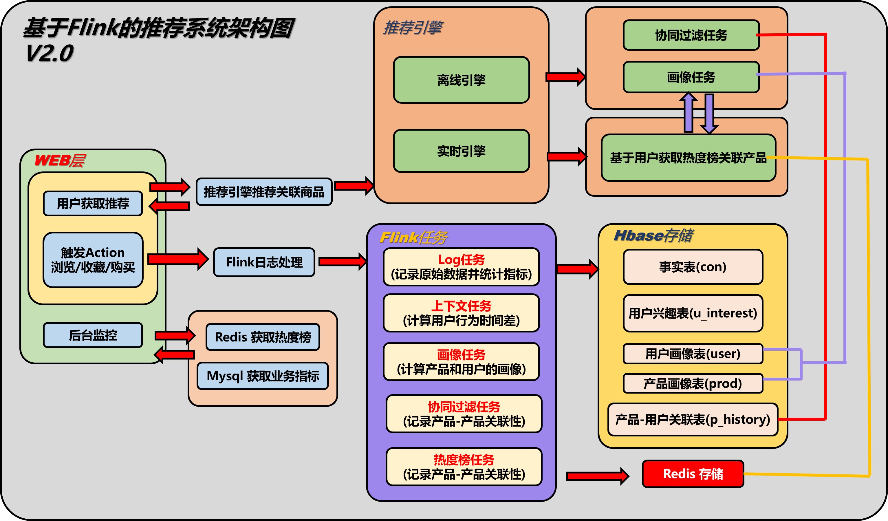
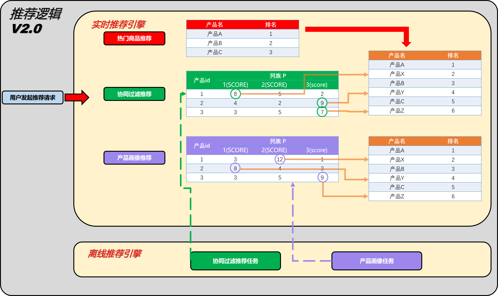
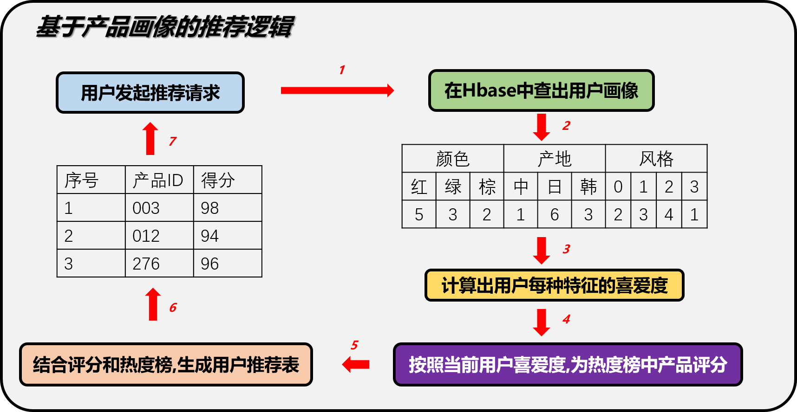
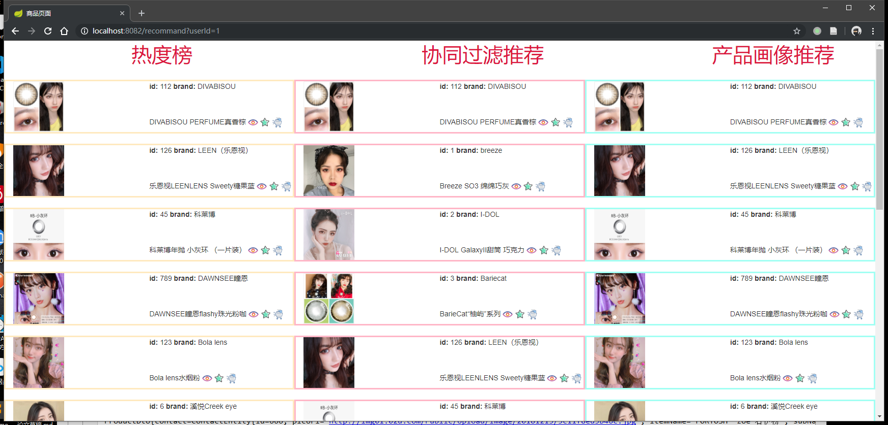
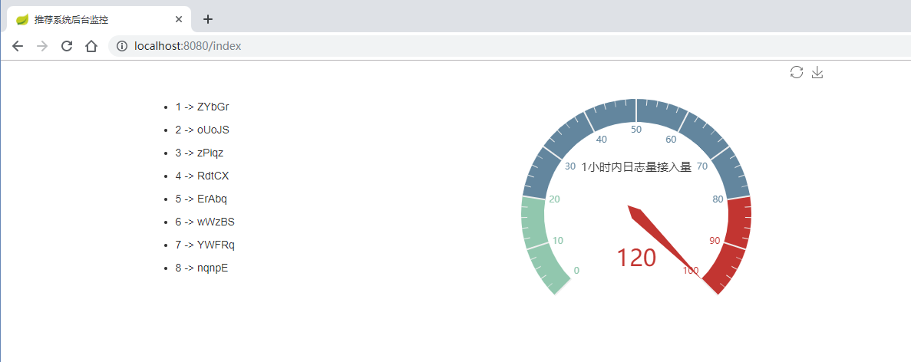

# 商品实时推荐系统

[English](README_EN.md) · [Contributing / 贡献](CONTRIBUTING.md) · [Apache-2.0](LICENSE)

[](https://github.com/water8394/flink-recommandSystem-demo/actions/workflows/ci.yml)

### 1. 系统架构  v2.0

- **1.1 系统架构图**

  <div align=center></div>

- **1.2模块说明**

- a.在日志数据模块(flink-2-hbase)中,又主要分为6个Flink任务:

  - 用户-产品浏览历史  -> 实现基于协同过滤的推荐逻辑 

    通过Flink去记录用户浏览过这个类目下的哪些产品,为后面的基于Item的协同过滤做准备
    实时的记录用户的评分到Hbase中,为后续离线处理做准备.

    数据存储在Hbase的p_history表

  - 用户-兴趣 -> 实现基于上下文的推荐逻辑

    根据用户对同一个产品的操作计算兴趣度,计算规则通过操作间隔时间(如购物 - 浏览 < 100s)则判定为一次兴趣事件
    通过Flink的ValueState实现,如果用户的操作Action=3(收藏),则清除这个产品的state,如果超过100s没有出现Action=3的事件,也会清除这个state

    数据存储在Hbase的u_interest表

  - 用户画像计算 -> 实现基于标签的推荐逻辑

    v1.0按照三个维度去计算用户画像,分别是用户的颜色兴趣,用户的产地兴趣,和用户的风格兴趣.根据日志不断的修改用户画像的数据,记录在Hbase中.

    数据存储在Hbase的user表

  - 产品画像记录  -> 实现基于标签的推荐逻辑

    用两个维度记录产品画像,一个是喜爱该产品的年龄段,另一个是性别

    数据存储在Hbase的prod表

  - 事实热度榜 -> 实现基于热度的推荐逻辑 

    通过Flink时间窗口机制,统计当前时间的实时热度,并将数据缓存在Redis中.

    通过Flink的窗口机制计算实时热度,使用ListState保存一次热度榜

    数据存储在redis中,按照时间戳存储list

  - 日志导入

    从Kafka接收的数据直接导入进Hbase事实表,保存完整的日志log,日志中包含了用户Id,用户操作的产品id,操作时间,行为(如购买,点击,推荐等).

    数据按时间窗口统计数据大屏需要的数据,返回前段展示

    数据存储在Hbase的con表

- b. web模块

  - 前台用户界面

    该页面返回给用户推荐的产品list

  - 后台监控页面

    该页面返回给管理员指标监控


### 2.推荐引擎逻辑说明

- **2.1 基于热度的推荐逻辑**

  现阶段推荐逻辑图

<div align=center></div>

​    根据用户特征，重新排序热度榜，之后根据两种推荐算法计算得到的产品相关度评分，为每个热度榜中的产品推荐几个关联的产品

- **2.2 基于产品画像的产品相似度计算方法**

  基于产品画像的推荐逻辑依赖于产品画像和热度榜两个维度,产品画像有三个特征,包含color/country/style三个角度,通过计算用户对该类目产品的评分来过滤热度榜上的产品

  <div align=center></div>

  在已经有产品画像的基础上,计算item与item之间的关联系,通过**余弦相似度**来计算两两之间的评分,最后在已有物品选中的情况下推荐关联性更高的产品.

| 相似度 | A    | B    | C    |
| ------ | ---- | ---- | ---- |
| A      | 1    | 0.7  | 0.2  |
| B      | 0.7  | 1    | 0.6  |
| C      | 0.2  | 0.6  | 1    |

  

- **2.3 基于协同过滤的产品相似度计算方法**

  根据产品用户表（Hbase） 去计算公式得到相似度评分：

  
                 

### 3. 前台推荐页面

​ 当前推荐结果分为3列,分别是热度榜推荐,协同过滤推荐和产品画像推荐

<div align=center></div>

### 4. 后台数据大屏

​ **在后台上显示推荐系统的实时数据**,数据来自其他Flink计算模块的结果.目前包含热度榜和1小时日志接入量两个指标. 
真实数据位置在resource/database.sql

<div align=center></div>

### 5. 快速开始

部署步骤都在本仓库里，不需要再打开外部文章。原先 README 中的「文章地址」（`xinze.fun` 上的 Docker 部署文）已经失效，并且会跳到无关站点，这里不再保留该链接，也不再链到简书 / CSDN 上的旧搭建笔记。那些笔记描述的是另一套手工拉镜像的做法，和当前的 `docker-compose.yml` 对不上。

英文对照见 [README_EN.md](README_EN.md)。

#### 5.1 环境

| 依赖 | 版本 |
| --- | --- |
| JDK | **11 或 17**。用更高版本可以编译（`maven.compiler.release` 是 11），但 **Flink 1.18 作业不要用 JDK 21 运行**。CI 使用 Temurin 17。 |
| Maven | 3.8 及以上 |
| Docker | Docker Engine，以及 Compose v2（命令是 `docker compose`，不是 `docker-compose`） |
| 内存 | 建议留给 Docker 和作业的内存不少于 6 GB |
| 端口 | `9092` Kafka，`2181` / `16000` / `16010` / `16020` / `16030` HBase，`6379` Redis，`3308` MySQL，`8081` Flink UI，`8082` 网页 |

不强制使用 Docker。Kafka、HBase、Redis、MySQL 用自己已有的实例也可以，把 `flink-2-hbase/src/main/resources/config.properties` 和 `web/src/main/resources/application.yml` 里的地址改成你的实例即可。下面的步骤按仓库里的 compose 文件来写。

#### 5.2 启动依赖（一条命令）

在仓库根目录：

```bash
./scripts/bootstrap.sh
```

脚本会执行 `docker compose -f resources/docker/docker-compose/docker-compose.yml up -d --build`，然后等到下面这些事情做完才退出：

- **MySQL 8.0** 第一次启动时导入 `resources/docker/docker-compose/contact.sql`，建库 `con`，并写入 `contact`、`product`、`user` 三张表。宿主机端口是 **3308**（容器内仍是 3306），账号 `root` / `123456`。
- **HBase 2.6.7**（单机，自带 ZooKeeper）第一次启动时执行 `resources/docker/docker-compose/hbase_ini.sql`，创建 `con`、`prod`、`user`、`u_history`、`p_history`、`ps`、`px`、`u_interest`。宿主机端口是 `2181`，Master 页面是 <http://localhost:16010>。客户端 quorum 写的是 `127.0.0.1`，不要改成 `localhost`：`localhost` 经常还会解析到 `::1`，连上 IPv6 会被复位，客户端就一直起不来。容器里的 ZooKeeper 监听 `0.0.0.0`，发布出来的 `2181` 才能进来。
- **Kafka 3.9.2（KRaft，没有 ZooKeeper）** 由 `kafka-init` 创建主题 `con`（1 个分区）。宿主机用 `localhost:9092`，compose 网络内部用 `kafka:19092`。
- **Redis 7.4** 在 `localhost:6379`。
- **Flink 1.18.1** 的 JobManager / TaskManager 会起来，UI 在 <http://localhost:8081>。

这些服务没有挂数据卷。`docker compose down` 会删掉容器里的数据，下次 `up` 会重新初始化。只是 `restart` 不会清数据。

Kafka、Redis、MySQL 在配置里是宿主机上的 `localhost`。HBase 的 ZooKeeper 地址是 `127.0.0.1`（原因见上）。因此 **不要** 把作业 `flink run` 进上面的 TaskManager：容器里的 `localhost` 是容器自己，连不上 Kafka / HBase / Redis / MySQL。作业用下一节的脚本在宿主机网络里跑。Flink UI 仍然可以打开，用来确认集群进程活着。

#### 5.3 编译

```bash
mvn -B package
```

会构建 `flink-2-hbase` 和 `web`，并跑不依赖外部服务的单元测试。需要连 MySQL / Redis / HBase 的旧测试默认排除，见 [CONTRIBUTING.md](CONTRIBUTING.md)。

#### 5.4 启动六个 Flink 作业

先启动作业，再灌数据。作业从 Kafka **最新位点** 开始消费，作业起来之前写入的消息不会被看到。

```bash
./scripts/run-flink-jobs.sh
```

Linux 上这个脚本用 Flink 1.18 镜像、`--network host` 起一个容器（Java 11），一次拉起六个作业。其它系统如果装了 JDK 11 或 17，脚本改为在本机 `java -cp` 启动。日志：

```bash
docker logs -f flink-demo-jobs
```

六个入口类：

| 类 | 作用 | 写出位置 |
| --- | --- | --- |
| `com.demo.task.LogTask` | 原始日志落库 | HBase `con` |
| `com.demo.task.UserHistoryTask` | 用户-商品、商品-用户历史 | HBase `u_history`、`p_history` |
| `com.demo.task.UserInterestTask` | 兴趣 | HBase `u_interest` |
| `com.demo.task.UserPortraitTask` | 用户画像（读 MySQL `product`） | HBase `user` |
| `com.demo.task.ProductProtaritTask` | 商品画像（读 MySQL `user`） | HBase `prod` |
| `com.demo.task.TopProductTask` | 60 秒滑动窗口热度榜，每 5 秒滑动 | Redis 键 `0`..`4` |

日志行格式是 `userId,productId,秒级时间戳,action`。`action`：`1` 浏览，`2` 收藏，`3` 购买。

热度榜用的是事件时间。窗口长度 60 秒，所以测试数据的时间戳需要覆盖大约一分钟，不能只发“当前这一秒”的几条就指望榜单出来。`generate-logs.sh` 的默认模式已经把时间戳铺在最近 100 秒里。

相似度（HBase 表 `px`、`ps`）不是 Flink 作业，而是本机定时任务 `com.demo.scheduler.SchedulerJob`，它读 `p_history` 再写回这两张表。不跑它时，推荐页的后两列会先显示热度榜里的商品，只是没有额外的相关商品。需要的话在作业容器或本机执行：

```bash
java -cp flink-2-hbase/target/flink-2-hbase-1.0-SNAPSHOT.jar com.demo.scheduler.SchedulerJob
```

停作业：

```bash
./scripts/stop-flink-jobs.sh
```

#### 5.5 灌入测试数据

确认作业日志里已经出现任务启动（容器大约需要半分钟），然后：

```bash
./scripts/generate-logs.sh
```

默认一次写入 200 条。商品 id 集中在 11–15（这些 id 在 `product` 和 `contact` 里都有），其中 11 最多，热度榜第一名应是 `11`。持续随机写入：

```bash
./scripts/generate-logs.sh --follow
```

也可以进 Kafka 容器执行挂载好的 `resources/docker/docker-compose/generator.sh`（`MODE=follow` 为死循环，`MODE=once` 为上面这一批）。

页面上的浏览 / 收藏 / 购买按钮会请求 `GET /log?id=&prod=&action=`，由 Web 再写入同一个主题 `con`。

#### 5.6 补齐热度榜键，并打开网页

热度作业只写 Redis 键 `0` 到 `4`。页面要读 `0` 到 `9`。不足 10 个键时，代码会用 `product` 表把列表垫到很长，再按下标去取 `contact`，商品 1、2 在 `contact` 里不存在，页面会 500。页面按位置去对 `contact` / `product` 的查询结果，而查询对每个 id 只返回一行，所以热度榜里如果出现重复 id，列表比 Redis 短，同样会 500。脚本只补空键，并替换已经在前面名次里出现过的 id（从 20 起，这些 id 在两张表里都有），不会改掉作业已经写入的名次：

```bash
./scripts/seed-hotlist.sh
```

启动网站（脚本在没设置 `JAVA_HOME` 时优先用本机 JDK 17）：

```bash
./scripts/run-web.sh
```

不要在仓库根目录执行 `mvn spring-boot:run`。根 POM 不是 Spring Boot 工程，插件要么找不到，要么会跑到 `flink-2-hbase` 上，因为那里有十几个 `main`。`run-web.sh` 先 `install` Flink 模块，再只对 `web` 执行 `spring-boot:run`。

浏览器打开：

- 推荐页：<http://localhost:8082/recommand?userId=1>
- 后台热度：<http://localhost:8082/index>

推荐页应出现三列：热度榜、协同过滤推荐、产品画像推荐，并且能看到商品名。图片地址是多年前的外链，打不开不影响列表本身。

自查（网页已启动时把地址传进去）：

```bash
./scripts/verify-demo.sh http://localhost:8082
```

Redis 里 `GET 0` 在热度作业算完后应为 `11`。HBase 表 `con` 里应能扫到日志行。

#### 5.7 常见问题

1. **以前的文章链接打不开，或跳到奇怪的网站。** 不要再使用那个链接。按本节从 `./scripts/bootstrap.sh` 开始即可。
2. **`docker compose up` 马上返回，网页里却没有数据。** `up -d` 不会等 MySQL 导完、HBase 建完表。用 `./scripts/bootstrap.sh`，或看 `docker ps` 里的 health 状态，以及 `docker logs mysql`、`docker logs hbase`、`docker logs kafka-init`。
3. **端口被占用。** 先确认本机没有另一套 Kafka / MySQL / Redis / HBase。MySQL 映射的是 **3308**，不是 3306。
4. **HBase 客户端超时、`2181` 连接被复位，或连到 `localhost:9000`。** `config.properties` 里的 RPC / scanner 超时是 60 秒，quorum 是 `127.0.0.1`，并且不再把 `hbase.rootdir` 指到一个不存在的 HDFS。`echo ruok | nc -4 127.0.0.1 2181` 应返回 `imok`。HBase 在 compose 里把 RegionServer 广告成 `localhost`，所以客户端要跑在宿主机上（或 Linux 的 `--network host`），不要跑在别的容器网段里。
5. **作业提交进 Flink UI 那个集群后一直没有输出。** 容器内的 `localhost:9092` 不是宿主机的 Kafka。用 `./scripts/run-flink-jobs.sh`。
6. **用 JDK 21 跑作业直接退出。** 换成 11 或 17。编译可以继续用 21。
7. **灌了数据，Redis 仍然没有 `0`。** 作业是否在灌数据之前已经启动；日志时间戳是否覆盖了 60 秒事件时间；`docker logs flink-demo-jobs` 里有没有 HBase / Kafka 异常。
8. **`/recommand` 返回 500，堆栈里是下标越界或 `contact` 为空。** 跑 `./scripts/seed-hotlist.sh`。10 个键都要有值，值不能重复，并且每个商品 id 都要同时在 `product` 和 `contact` 里（样例数据从 3 开始，脚本补位用 20 起）。
9. **`/recommand` 返回 500，堆栈里是 Thymeleaf 拒绝 `th:onclick` 里的字符串拼接。** Spring Boot 2.7 自带的 Thymeleaf 不允许在事件属性里拼接字符串。页面按钮已经改成 `data-*` 属性，点击仍调用原来的 `sendLog`。不要把 `th:onclick="'javascript:sendLog('+${userId}+..."` 加回去。
10. **页面有商品名但没有图片。** 图片 URL 是外部站点，很多已经失效。
11. **改完 `contact.sql` 或 HBase 脚本却没有生效。** 初始化只在数据目录还是空的时候做。`docker compose -f resources/docker/docker-compose/docker-compose.yml down` 后再 `./scripts/bootstrap.sh`。
12. **防火墙或只绑了内网 IP。** 本 compose 把服务发布在 `0.0.0.0` 的上述端口上。安全组或本机防火墙要放行你实际访问用的端口。
13. **`kafka-init` 一直不退出，日志是空的，Flink UI 里也没有 TaskManager。** 容器之间互相连不上。宿主机上发布的端口仍然通，所以容易误判成 Kafka 或 Flink 自己坏了。在 Linux 上同时看 `iptables` 和 `iptables-legacy` 的 `FORWARD` 链：策略是 `DROP`、并且只放行 `docker0` 时，compose 自己的网桥会被丢掉。放行那块网桥之后执行 `docker restart kafka-init`，再看 `docker logs flink-taskmanager` 里是否注册成功。
14. **`mvn spring-boot:run` 失败。** 根目录没有这个插件；加上完整坐标再带 `-am` 时，插件会作用到 `flink-2-hbase`，报找不到唯一的 main class。用 `./scripts/run-web.sh`。

### 6. 许可证

本仓库以 [Apache License 2.0](LICENSE) 授权，版权归仓库作者 **water8394 (XInZE)** 所有。
